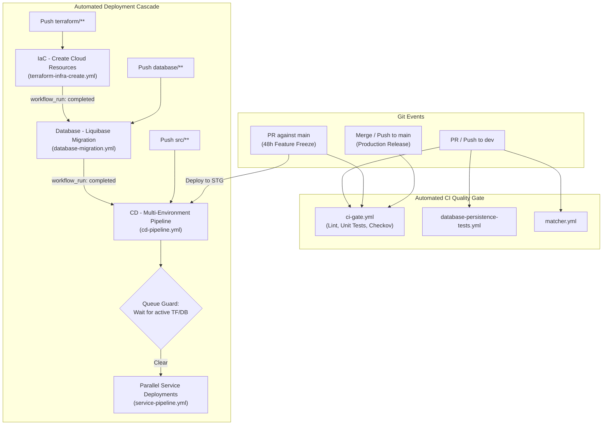

# CI/CD & GitHub Actions Workflows Guide

**Repository:** `nus-iss-dmss-practice-module-team5/team5-ewaste-scalable-systems`
**Module:** SWE5001 Architecting Scalable Systems — Practice Module (Team 5)
**Target Cloud:** Microsoft Azure (Container Apps, Private Link ACR, MySQL Flexible Server, Event Hubs)

---

## 1. Automated Triggers: When Workflows Run Automatically

The platform features an automated GitOps deployment cascade where code commits, pull requests, and upstream workflow completions trigger downstream jobs automatically.

### Automated End-to-End Cascade Flow



### Complete Automated Trigger Matrix

| Workflow Name | Workflow File | Automated Trigger Event | Branch Filters | File Path Filters | Target Azure Environment |
| :--- | :--- | :--- | :--- | :--- | :--- |
| **CI Quality Gate & Security Baseline** | [`ci-gate.yml`](./ci-gate.yml) | `pull_request`, `push` | `dev`, `main` | *All files* (Any change triggers quality gate) | N/A (Build verification only) |
| **Database Persistence Tests** | [`database-persistence-tests.yml`](./database-persistence-tests.yml) | `pull_request`, `push` | `dev`, `main` | `database/**`, `src/backend/**`, `scripts/test-persistence.sh` | N/A (Temporary containerized MySQL) |
| **Matcher & Analytics Contract Tests** | [`matcher.yml`](./matcher.yml) | `pull_request`, `push` | `dev`, `main` | `src/matcher/**`, `src/backend/**`, `contracts/**`, `scripts/test-*.sh` | N/A (Mocked Kafka / Go testbed) |
| **IaC - Create Cloud Resources** | [`terraform-infra-create.yml`](./terraform-infra-create.yml) | `push`<br>`pull_request` | `dev`, `main`<br>`main` | `terraform/**`, `.github/workflows/terraform-infra-create.yml` | `dev` (on push to `dev`)<br>`stg` (on PR to `main`)<br>`prod` (on push to `main`) |
| **Database - Liquibase Migration** | [`database-migration.yml`](./database-migration.yml) | `workflow_run`<br>`push`<br>`pull_request` | `dev`, `main`<br>`dev`, `main`<br>`main` | Triggered when `IaC - Create Cloud Resources` finishes.<br>`database/**`, `.github/workflows/database-migration.yml` | Automatically matches upstream trigger branch (`dev` $\to$ `dev`, `main` $\to$ `prod`) |
| **CD - Multi-Environment Pipeline** | [`cd-pipeline.yml`](./cd-pipeline.yml) | `workflow_run`<br>`push`<br>`pull_request` | `dev`, `main`<br>`dev`, `main`<br>`main` | Triggered when `Database - Liquibase Migration` finishes.<br>`src/**`, `contracts/**`, `scripts/**`, `terraform/**`<br>PR to `main` triggers Staging deployment | `dev` (on `dev` branch)<br>`stg` (on PR to `main`)<br>`prod` (on `main` branch) |
| **Service Pipeline** | [`service-pipeline.yml`](./service-pipeline.yml) | `workflow_call` | Inherits caller | Triggered dynamically by `cd-pipeline.yml` only for microservices whose code paths actually changed | Inherits from `cd-pipeline.yml` |
| **IaC - Destroy Cloud Resources** | [`terraform-infra-destroy.yml`](./terraform-infra-destroy.yml) | **None** | None | **Never triggered automatically** (Safety-gated manual destruction only) | Manual choice (`dev` or `stg`) |
| **Terraform - Break Azure State Lock** | [`terraform-release-lock.yml`](./terraform-release-lock.yml) | **None** | None | **Never triggered automatically** (Emergency operational tool) | Specified by operator |

---

## 2. Manual Triggers: How to Trigger Workflows from the GitHub UI

Workflows that support manual triggering are configured with `workflow_dispatch`. You can execute them directly from your web browser without creating a commit.

### Step-by-Step GitHub UI Guide

1. Navigate to the repository on GitHub:
   [`https://github.com/nus-iss-dmss-practice-module-team5/team5-ewaste-scalable-systems`](https://github.com/nus-iss-dmss-practice-module-team5/team5-ewaste-scalable-systems)
2. Click the **Actions** tab in the top navigation bar.
3. In the left sidebar under **Workflows**, click the specific workflow you want to run.
4. If the workflow supports manual execution, a blue banner will appear above the workflow run list with a **"Run workflow"** button.
5. Click **"Run workflow"**, select the **Branch**, configure the input parameters, and click the green **"Run workflow"** button to start execution.

---

### UI Inputs & Configuration per Workflow

#### 1. CD - Multi-Environment Deployment & Evidence Pipeline
*Use this to deploy or redeploy microservices to Dev, Staging, or Production.*

- **UI Location:** **Actions** $\to$ **CD - Multi-Environment Deployment & Evidence Pipeline** $\to$ **Run workflow**
- **Inputs:**
  - **Use workflow from:** Select the branch containing the code to deploy (e.g. `main`, `dev`, or `feature/*`).
  - **`target_env`** *(Required, Choice)*:
    - `dev`: Deploys to `rg-ewastescalable-dev`
    - `stg`: Deploys to `rg-ewastescalable-stg`
    - `prod`: Deploys to `rg-ewastescalable-prod`
  - **`services`** *(Optional, String, Default: `all`)*:
    - Enter `all` to build and deploy the entire 7-service fleet.
    - Or enter a comma-separated list of service identifiers to deploy specific services only:
      ```text
      ui, auth, api, claim, custody, matcher, analytics
      ```
  - **`rollback_tag`** *(Optional, String, Default: empty)*:
    - Leave empty for normal builds from current source code.
    - Enter `PREVIOUS` for an automatic zero-downtime rollback to each service's previous (N-1) deployed container image.
    - Or enter an exact ACR image tag (e.g. `dev-39352009366`).

#### 2. IaC - Create Cloud Resources (Dev, Stg, Prod)
*Use this to provision or update Azure infrastructure (VNet, ACA, MySQL, Event Hubs, Runner VM) via Terraform.*

- **UI Location:** **Actions** $\to$ **IaC - Create Cloud Resources (Dev, Stg, Prod)** $\to$ **Run workflow**
- **Inputs:**
  - **Use workflow from:** Select branch (`dev` or `main`).
  - **`target_env`** *(Required, Choice, Default: `dev`)*:
    - `dev`: Applies Terraform to `environments/dev.tfvars`
    - `stg`: Applies Terraform to `environments/stg.tfvars`
    - `prod`: Applies Terraform to `environments/prod.tfvars`
  - **`action`** *(Required, Choice, Default: `apply`)*:
    - `apply`: Executes `terraform apply` to create/update cloud infrastructure.
    - `plan`: Executes `terraform plan` only, displaying planned changes without modifying Azure resources.

#### 3. Database - Liquibase Migration
*Use this to run database migrations, inspect changelog status, or validate changelogs against Azure MySQL.*

- **UI Location:** **Actions** $\to$ **Database - Liquibase Migration** $\to$ **Run workflow**
- **Inputs:**
  - **Use workflow from:** Select branch.
  - **`target_env`** *(Required, Choice, Default: `dev`)*:
    - `dev`: Migrates database in `rg-ewastescalable-dev`
    - `stg`: Migrates database in `rg-ewastescalable-stg`
    - `prod`: Migrates database in `rg-ewastescalable-prod`
  - **`command`** *(Required, Choice, Default: `update`)*:
    - `update`: Applies pending Liquibase changeSets from `database/changelog-master.yaml` to the target database.
    - `status`: Outputs pending changelogs without modifying schema.
    - `validate`: Checks changelog YAML and SQL syntax against the Liquibase parser.

#### 4. IaC - Destroy Cloud Resources (Dev & Stg Only)
*Safety-gated teardown workflow to destroy temporary environments and reclaim Azure cloud credits.*

- **UI Location:** **Actions** $\to$ **IaC - Destroy Cloud Resources (Dev & Stg Only)** $\to$ **Run workflow**
- **Inputs:**
  - **`target_env`** *(Required, Choice, Default: `dev`)*:
    - `dev`: Destroys resources in `rg-ewastescalable-dev`
    - `stg`: Destroys resources in `rg-ewastescalable-stg`
    - *(Note: Production `prod` is intentionally excluded and cannot be destroyed via this workflow).*
  - **`confirmation`** *(Required, String)*:
    - You **must** type exactly:
      ```text
      DESTROY_CONFIRM
      ```
    - Any other value will cause the workflow to fail immediately without touching infrastructure.

#### 5. Terraform - Break Azure State Lock
*Emergency tool to release a hung blob lease on remote `.tfstate` if a pipeline fails mid-execution.*

- **UI Location:** **Actions** $\to$ **Terraform - Break Azure State Lock** $\to$ **Run workflow**
- **Inputs:**
  - **`storage_account`** *(Required, String)*: Name of state storage account (e.g. `stgewastescalabletfstate`).
  - **`container_name`** *(Required, String, Default: `tfstate`)*: Blob container name.
  - **`blob_name`** *(Required, String)*: State file name (e.g. `dev.tfstate`, `stg.tfstate`, or `prod.tfstate`).

#### 6. Database Schema, Migration and Persistence Tests
*Runs automated schema validation and repository persistence integration tests against a disposable container.*

- **UI Location:** **Actions** $\to$ **Database Schema, Migration and Persistence Tests** $\to$ **Run workflow**
- **Inputs:** None required (select branch and click **Run workflow**).

#### 7. Matching and Analytics Contracts, Kafka and MySQL Persistence
*Verifies Kafka worker rebalancing, consumer group failover, and message replay under load.*

- **UI Location:** **Actions** $\to$ **Matching and Analytics Contracts, Kafka and MySQL Persistence** $\to$ **Run workflow**
- **Inputs:** None required (select branch and click **Run workflow**).

---

### Workflows NOT Directly Dispatched from the UI

1. **`ci-gate.yml` (CI Quality Gate & Security Baseline):**
   - **Why:** Designed strictly as an automated branch protection gate that runs on every `push` and `pull_request`. It validates all linters, unit tests, and security scans for pull request review.
2. **`service-pipeline.yml` (Service Pipeline):**
   - **Why:** Configured as a reusable `workflow_call` template. It cannot be launched standalone because it requires caller inputs (`commit`, `environment`, `resource_group`, `service`) provided by the master orchestrator [`cd-pipeline.yml`](./cd-pipeline.yml).

---

## 3. Self-Hosted VNet Runner Architecture

To maintain strict network isolation, the Azure Container Registry (ACR), Azure Database for MySQL Flexible Server, and Azure Storage accounts have **public network access disabled** or restricted behind Private Endpoints.

Deployment steps requiring internal VNet access run on a dedicated **Self-Hosted GitHub Actions Runner**:

- **Virtual Machine:** `vm-runner-ewastescalable-prod` (Standard_B2als_v2, Ubuntu 22.04 LTS, 64 GB OS Disk)
- **VNet Injection:** Subnet `snet-runner` (`10.0.4.0/24`) in `vnet-ewastescalable-${env}`
- **Security Posture:** Zero inbound open ports (`DenyAllInboundInternet`). Outbound HTTPS long-polling connection to the GitHub Actions control plane.
- **Identity & RBAC:** User-Assigned Managed Identity (`id-runner-ewastescalable-${env}`) with passwordless `AcrPush` and `AcrPull` roles.
- **Disk Maintenance:** Automated recurring daily cron job (`/etc/cron.d/docker-prune`) executing `docker system prune -af --filter "until=48h"` to prevent disk exhaustion from container build layers.
- **Runner Labels Matrix:**
  ```text
  self-hosted, azure-vnet, dev, stg, prod
  ```
- **Assigned Workloads:**
  - `database-migration.yml`: Executes Liquibase migrations directly against private MySQL (`10.0.2.x`).
  - `service-pipeline.yml` (`deploy` stage): Pushes images to private ACR (`privatelink.azurecr.io`), updates Container App revisions, and tests internal `/healthz` endpoints.

---

## 4. Deep-Dive: Workflow Specifications

### 4.1 CI Quality Gate & Security Baseline (`ci-gate.yml`)
- **Execution Matrix:**
  - **Backend (Go 1.26):** `golangci-lint`, `go test -race -coverprofile`, check compile of all 4 cmd entrypoints (`batch-workflow`, `claim-logistics`, `custody-verification`, `identity-access`).
  - **Frontend (Node 22 / Next.js 15):** ESLint, TypeScript compilation check (`tsc --noEmit`), Vitest test suite.
  - **Workers (Python 3.11):** `flake8`, `pytest`, contract validation against schemas.
  - **Security Baseline:** Checkov IaC security scan for Terraform, Trivy container vulnerability scanner, Gitleaks / pattern secret scanning.
- **Branch Protection Gate:** All checks must succeed before pull requests can merge into `dev` or `main`.

### 4.2 CD Multi-Environment Deployment (`cd-pipeline.yml`)
- **Queue Guard Mechanism:** If an upstream Terraform apply or Database Migration is actively running on the branch, `cd-pipeline.yml` automatically polls and waits (up to 15 minutes) rather than deploying against an unstable or transitioning schema.
- **Service Change Detection:** Inspects Git change deltas to deploy only modified services (e.g., changes in `src/frontend` trigger only `ship-ui`). Setting `services: "all"` forces deployment across all 7 services.
- **Rollback Integration:** Accepts optional `rollback_tag` input (e.g., `PREVIOUS` or specific release tag) to redeploy previous container images without code rebuilds.

### 4.3 Reusable Service Pipeline (`service-pipeline.yml`)
- **Stage 1 (Test):** Runs unit tests on GitHub-hosted `ubuntu-latest`.
- **Stage 2 (Build & Package):** Builds multi-arch Docker image with Buildx, tags image with Git SHA and environment, exports image tarball artifact.
- **Stage 3 (Deploy & Verify):** Runs on **`[self-hosted, azure-vnet, env]`**. Imports image tarball into Docker cache, logs in to private Azure Container Registry via Azure Managed Identity (`AcrPush`), pushes image, updates Azure Container App revision, and executes canary health validation against internal endpoint `/healthz`.

### 4.4 Database Liquibase Migration (`database-migration.yml`)
- **VNet Execution:** Runs on the self-hosted runner directly connected to `vnet-ewastescalable-${env}`.
- **Master Changelog:** [`database/changelog-master.yaml`](../../database/changelog-master.yaml), which references changeSets in `database/changes/*.sql` and seed data in `database/seed/*.sql`.
- **Migration Sequence:**
  1. Authenticates to Azure MySQL using managed credentials from Key Vault / GitHub Secrets.
  2. Runs `liquibase --changelog-file=database/changelog-master.yaml status`.
  3. Executes `liquibase update`.
  4. Exports deployment schema version artifact.

---

## 5. Environment Promotion & GitOps Strategy

| Environment | Branch Trigger | Target Resource Group | Purpose & Approval Gates |
| :--- | :--- | :--- | :--- |
| **Dev** | Push to `dev`, manual dispatch | `rg-ewastescalable-dev` | Rapid feature integration, automated sandbox smoke tests. |
| **Stg (Staging)** | PR targeting `main` | `rg-ewastescalable-stg` | 48-Hour Feature Freeze evaluation environment. Used for pre-release validation and stakeholder acceptance. |
| **Prod (Production)** | Merge to `main`, manual dispatch | `rg-ewastescalable-prod` | Live production baseline. Locked down, monitored via centralized Log Analytics. |

---

## 6. Required GitHub Secrets & Variables

Configure these repository secrets under **Settings $\to$ Secrets and variables $\to$ Actions**:

### Azure Cloud Credentials
| Secret Name | Description |
| :--- | :--- |
| `AZURE_CREDENTIALS` | Azure Service Principal JSON credentials (`clientId`, `clientSecret`, `subscriptionId`, `tenantId`). |
| `AZURE_TENANT_ID` | Microsoft Entra Tenant ID. |
| `AZURE_ACR_NAME` | Shared Azure Container Registry name (`acrewastescalable`). |

### Terraform Remote State
| Secret Name | Description |
| :--- | :--- |
| `TF_STATE_STORAGE_ACCOUNT` | Storage account hosting remote `.tfstate` blobs (`stgewastescalabletfstate`). |
| `TF_STATE_SA_ACCESS_KEY` | Storage account primary access key. |

### Database & Application Security Keys
| Secret Name | Description |
| :--- | :--- |
| `MYSQL_DB_ADMIN_PASSWORD` | MySQL Flexible Server administrator password. |
| `EWASTE_AUTH_ACCESS_SECRET` | Minimum 32-character HMAC secret for JWT Access Tokens. |
| `EWASTE_AUTH_REFRESH_SECRET` | Minimum 32-character secret for Refresh Tokens. |
| `EWASTE_AUTH_REFRESH_HASH_SECRET` | Secret for hashing persisted session tokens. |
| `MATCHER_SIGNING_SECRET` | Secret key used for signing batch matching requests between services. |
| `EWASTE_AUTH_ANALYTICS_SERVICE_TOKEN` | Service-to-service authentication token for analytics ingestion. |
| `GH_RUNNER_PAT` | GitHub Personal Access Token (`repo` scope) used by Terraform to register self-hosted runner VMs. |

---

## 7. CLI Operational Runbook (GitHub CLI Alternative to UI)

If you prefer triggering workflows from your terminal instead of the GitHub UI, use the GitHub CLI (`gh`):

```powershell
# 1. Trigger Terraform Plan or Apply
gh workflow run "IaC - Create Cloud Resources (Dev, Stg, Prod)" -f target_env=prod -f action=apply

# 2. Trigger Database Migration
gh workflow run "Database - Liquibase Migration" -f target_env=prod -f command=update

# 3. Deploy all microservices
gh workflow run "CD - Multi-Environment Deployment & Evidence Pipeline" -f target_env=prod -f services=all

# 4. Deploy only specific microservices (e.g., UI and API)
gh workflow run "CD - Multi-Environment Deployment & Evidence Pipeline" -f target_env=prod -f services="ui, api"

# 5. Rollback production to previous N-1 container images
gh workflow run "CD - Multi-Environment Deployment & Evidence Pipeline" -f target_env=prod -f rollback_tag=PREVIOUS

# 6. Destroy Dev or Staging environment (requires confirmation string)
gh workflow run "IaC - Destroy Cloud Resources (Dev & Stg Only)" -f target_env=dev -f confirmation=DESTROY_CONFIRM
```
