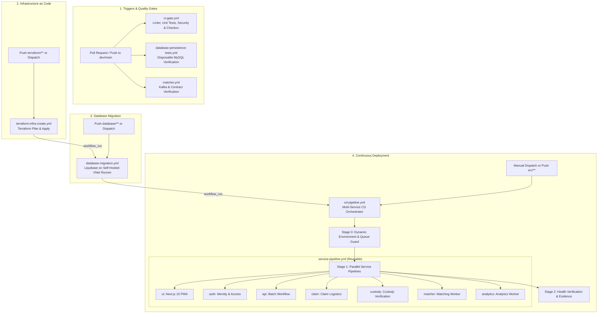

# CI/CD & GitHub Actions Workflows Guide

**Repository:** `nus-iss-dmss-practice-module-team5/team5-ewaste-scalable-systems`
**Module:** SWE5001 Architecting Scalable Systems — Practice Module (Team 5)
**Target Cloud:** Microsoft Azure (Container Apps, Private Link ACR, MySQL Flexible Server, Event Hubs)

---

## 1. CI/CD Architecture & Pipeline Orchestration

The platform employs an automated, zero-trust GitOps deployment lifecycle. Workflows are designed with strict separation of concerns, upstream queue guards, immutable digest-based image deployments, and VNet-isolated deployment execution.

### End-to-End Orchestration Flow



---

## 2. Self-Hosted VNet Runner Architecture

To maintain strict network isolation, the Azure Container Registry (ACR), Azure Database for MySQL Flexible Server, and Azure Storage accounts have **public network access disabled** or restricted behind Private Endpoints.

Deployment steps requiring internal VNet access run on a dedicated **Self-Hosted GitHub Actions Runner**:

- **Virtual Machine:** `vm-runner-ewastescalable-prod` (Standard_B2als_v2, Ubuntu 22.04 LTS)
- **VNet Injection:** Subnet `snet-runner` (`10.0.4.0/24`) in `vnet-ewastescalable-${env}`
- **Security Posture:** Zero inbound open ports (`DenyAllInboundInternet`). Outbound HTTPS long-polling connection to the GitHub Actions control plane.
- **Identity & RBAC:** User-Assigned Managed Identity (`id-runner-ewastescalable-${env}`) with passwordless `AcrPush` and `AcrPull` roles.
- **Runner Labels Matrix:**
  ```text
  self-hosted, azure-vnet, dev, stg, prod
  ```
- **Assigned Workloads:**
  - `database-migration.yml`: Executes Liquibase migrations directly against private MySQL (`10.0.2.x`).
  - `service-pipeline.yml` (`deploy` stage): Pushes images to private ACR (`privatelink.azurecr.io`), updates Container App revisions, and tests internal `/healthz` endpoints.

---

## 3. Workflow Catalog & Reference

| Workflow File | Workflow Name | Triggers | Runner Target | Primary Purpose |
| :--- | :--- | :--- | :--- | :--- |
| [`ci-gate.yml`](./ci-gate.yml) | **CI Quality Gate & Security Baseline** | PRs & pushes to `dev`, `main` | `ubuntu-latest` | Linting (golangci-lint, eslint, flake8), unit tests, Checkov IaC scanning, Trivy container scanning, secret detection. |
| [`cd-pipeline.yml`](./cd-pipeline.yml) | **CD - Multi-Environment Deployment & Evidence Pipeline** | `workflow_run` (after DB migration), pushes to `src/**`, `workflow_dispatch` | `ubuntu-latest` | Master CD coordinator. Resolves targets, checks upstream pipeline locks, dispatches parallel service builds, and verifies deployment evidence. |
| [`service-pipeline.yml`](./service-pipeline.yml) | **Service Pipeline** | `workflow_call` (invoked by `cd-pipeline.yml`) | Hybrid (`ubuntu-latest` for build; `self-hosted` for deploy) | Reusable 3-stage pipeline per service: (1) Test & Validate $\to$ (2) Build Docker image & Scan $\to$ (3) Deploy revision inside Azure VNet. Supports zero-downtime rollbacks via `rollback_tag`. |
| [`database-migration.yml`](./database-migration.yml) | **Database - Liquibase Migration** | `workflow_run` (after Terraform), pushes to `database/**`, `workflow_dispatch` | `[self-hosted, azure-vnet, env]` | Executes Liquibase changeSets against Azure MySQL inside private VNet. Creates changelog lock release safety net. |
| [`database-persistence-tests.yml`](./database-persistence-tests.yml) | **Database Schema, Migration and Persistence Tests** | PRs & pushes touching `database/**` or `src/backend/**` | `ubuntu-latest` | Runs isolated database persistence verification using temporary containerized MySQL. |
| [`matcher.yml`](./matcher.yml) | **Matching and Analytics Contracts, Kafka and MySQL Persistence** | PRs & pushes touching `src/matcher/**` or contracts | `ubuntu-latest` | Verifies Kafka consumer group rebalances, partition failovers, replay under load, and API contracts against mock Event Hubs. |
| [`terraform-infra-create.yml`](./terraform-infra-create.yml) | **IaC - Create Cloud Resources (Dev, Stg, Prod)** | Pushes to `terraform/**`, `workflow_dispatch` | `ubuntu-latest` | Runs Terraform `init`, `plan`, and `apply` across Dev, Staging, or Production Azure environments. |
| [`terraform-infra-destroy.yml`](./terraform-infra-destroy.yml) | **IaC - Destroy Cloud Resources (Dev & Stg Only)** | Manual `workflow_dispatch` | `ubuntu-latest` | Safety-gated teardown workflow. Strictly blocks production destruction; requires explicit confirmation string `DESTROY_CONFIRM`. |
| [`terraform-release-lock.yml`](./terraform-release-lock.yml) | **Terraform - Break Azure State Lock** | Manual `workflow_dispatch` | `ubuntu-latest` | Breaks stale blob leases on Azure Storage remote backend if a Terraform pipeline terminates unexpectedly. |

---

## 4. Deep-Dive: Workflow Specifications

### 4.1 CI Quality Gate & Security Baseline (`ci-gate.yml`)
- **Execution Matrix:**
  - **Backend (Go 1.26):** `golangci-lint`, `go test -race -coverprofile`, check compile of all 4 cmd entrypoints (`batch-workflow`, `claim-logistics`, `custody-verification`, `identity-access`).
  - **Frontend (Node 22 / Next.js 15):** ESLint, TypeScript compilation check (`tsc --noEmit`), Vitest test suite.
  - **Workers (Python 3.11):** `flake8`, `pytest`, contract validation against schemas.
  - **Security Baseline:** Checkov IaC security scan for Terraform, Trivy container vulnerability scanner, Gitleaks / pattern secret scanning.
- **Branch Protection Gate:** All checks must succeed before pull requests can merge into `dev` or `main`.

### 4.2 CD Multi-Environment Deployment (`cd-pipeline.yml`)
- **Queue Guard Mechanism:** If an upstream Terraform apply or Database Migration is actively running on the branch, `cd-pipeline.yml` automatically polls and waits (up to 15 minutes) rather than deploying against an unstable or transitioning schema.
- **Service Change Detection:** Inspects Git change deltas to deploy only modified services (e.g., changes in `src/frontend` trigger only `ship-ui`). Setting `services: "all"` forces deployment across all 7 services.
- **Rollback Integration:** Accepts optional `rollback_tag` input (e.g., `PREVIOUS` or specific release tag) to redeploy previous container images without code rebuilds.

### 4.3 Reusable Service Pipeline (`service-pipeline.yml`)
- **Stage 1 (Test):** Runs unit tests on GitHub-hosted `ubuntu-latest`.
- **Stage 2 (Build & Package):** Builds multi-arch Docker image with Buildx, tags image with Git SHA and environment, exports image tarball artifact.
- **Stage 3 (Deploy & Verify):** Runs on **`[self-hosted, azure-vnet, env]`**. Imports image tarball into Docker cache, logs in to private Azure Container Registry via Azure Managed Identity (`AcrPush`), pushes image, updates Azure Container App revision, and executes canary health validation against internal endpoint `/healthz`.

### 4.4 Database Liquibase Migration (`database-migration.yml`)
- **VNet Execution:** Runs on the self-hosted runner directly connected to `vnet-ewastescalable-${env}`.
- **Migration Sequence:**
  1. Authenticates to Azure MySQL using managed credentials from Key Vault / GitHub Secrets.
  2. Runs `liquibase --changeLogFile=database/changelog/root.changelog.xml status`.
  3. Executes `liquibase update`.
  4. Exports deployment schema version artifact.

---

## 5. Environment Promotion & GitOps Strategy

| Environment | Branch Trigger | Target Resource Group | Purpose & Approval Gates |
| :--- | :--- | :--- | :--- |
| **Dev** | Push to `dev`, manual dispatch | `rg-ewastescalable-dev` | Rapid feature integration, automated sandbox smoke tests. |
| **Stg (Staging)** | PR targeting `main` | `rg-ewastescalable-stg` | 48-Hour Feature Freeze evaluation environment. Used for pre-release validation and stakeholder acceptance. |
| **Prod (Production)** | Merge to `main`, manual dispatch | `rg-ewastescalable-prod` | Live production baseline. Locked down, monitored via centralized Log Analytics. |

---

## 6. Required GitHub Secrets & Variables

Configure these repository secrets under **Settings $\to$ Secrets and variables $\to$ Actions**:

### Azure Cloud Credentials
| Secret Name | Description |
| :--- | :--- |
| `AZURE_CREDENTIALS` | Azure Service Principal JSON credentials (`clientId`, `clientSecret`, `subscriptionId`, `tenantId`). |
| `AZURE_TENANT_ID` | Microsoft Entra Tenant ID (`adbeb191-a535-49b4-a660-fb8d484e74ee`). |
| `AZURE_ACR_NAME` | Shared Azure Container Registry name (`acrewastescalable`). |

### Terraform Remote State
| Secret Name | Description |
| :--- | :--- |
| `TF_STATE_STORAGE_ACCOUNT` | Storage account hosting remote `.tfstate` blobs (`stgewastescalabletfstate`). |
| `TF_STATE_SA_ACCESS_KEY` | Storage account primary access key. |

### Database & Application Security Keys
| Secret Name | Description |
| :--- | :--- |
| `MYSQL_DB_ADMIN_PASSWORD` | MySQL Flexible Server administrator password. |
| `EWASTE_AUTH_ACCESS_SECRET` | Minimum 32-character HMAC secret for JWT Access Tokens. |
| `EWASTE_AUTH_REFRESH_SECRET` | Minimum 32-character secret for Refresh Tokens. |
| `EWASTE_AUTH_REFRESH_HASH_SECRET` | Secret for hashing persisted session tokens. |
| `MATCHER_SIGNING_SECRET` | Secret key used for signing batch matching requests between services. |
| `EWASTE_AUTH_ANALYTICS_SERVICE_TOKEN` | Service-to-service authentication token for analytics ingestion. |
| `GH_RUNNER_PAT` | GitHub Personal Access Token (`repo` scope) used by Terraform to register self-hosted runner VMs. |

---

## 7. Operational Runbook: How to Trigger Workflows

### Trigger Infrastructure Deployment (Terraform)
```powershell
# Deploy infrastructure to Dev
gh workflow run "IaC - Create Cloud Resources (Dev, Stg, Prod)" -f target_env=dev -f action=apply

# Deploy infrastructure to Production
gh workflow run "IaC - Create Cloud Resources (Dev, Stg, Prod)" -f target_env=prod -f action=apply
```

### Trigger Database Migrations Manually
```powershell
gh workflow run "Database - Liquibase Migration" -f target_env=dev
gh workflow run "Database - Liquibase Migration" -f target_env=prod
```

### Trigger Full or Partial Service Deployment
```powershell
# Deploy all microservices to Dev
gh workflow run "CD - Multi-Environment Deployment & Evidence Pipeline" -f target_env=dev -f services=all

# Deploy only the UI and API microservices to Prod
gh workflow run "CD - Multi-Environment Deployment & Evidence Pipeline" -f target_env=prod -f services="ui, api"
```

### Perform an Immediate Zero-Downtime Rollback
```powershell
# Rollback all services in production to their previous N-1 releases
gh workflow run "CD - Multi-Environment Deployment & Evidence Pipeline" -f target_env=prod -f rollback_tag=PREVIOUS
```
