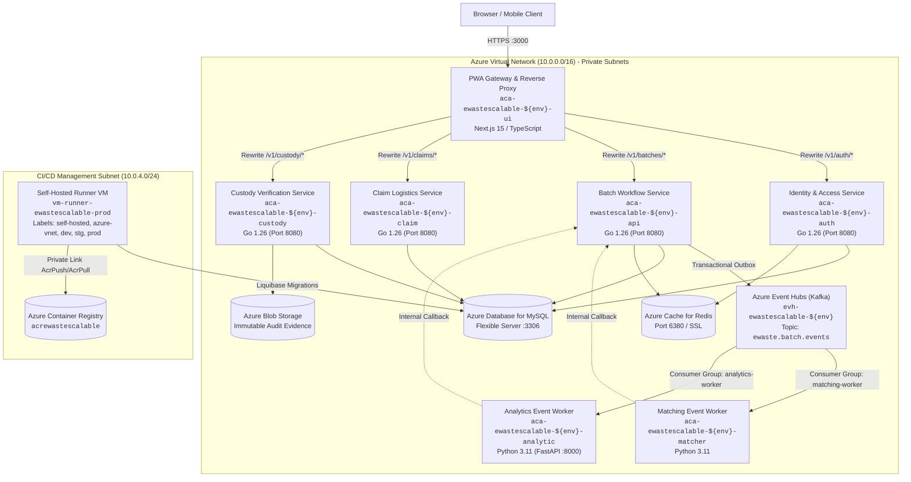

# Responsible E-Waste Chain-of-Custody Platform

[](https://github.com/nus-iss-dmss-practice-module-team5/team5-ewaste-scalable-systems/actions/workflows/ci-gate.yml)
[](https://github.com/nus-iss-dmss-practice-module-team5/team5-ewaste-scalable-systems/actions/workflows/cd-pipeline.yml)
[](https://github.com/nus-iss-dmss-practice-module-team5/team5-ewaste-scalable-systems/actions/workflows/database-migration.yml)
[](https://github.com/nus-iss-dmss-practice-module-team5/team5-ewaste-scalable-systems/actions/workflows/terraform-infra-create.yml)

**Academic Module:** SWE5001 Architecting Scalable Systems — Practice Module
**Institution:** National University of Singapore, Institute of Systems Science (NUS-ISS)
**Team:** Team 5
**Target Platform:** Microsoft Azure (Container Apps, Private Link ACR, MySQL Flexible Server, Azure Event Hubs)

---

## 1. Executive Summary & Problem Domain

The **Responsible E-Waste Chain-of-Custody Platform** provides an enterprise-grade, cloud-native foundation for tracking electronic waste from donor submission through collection, logistics handoff, treatment, and recycling certification.

### Key Architectural Tenets
- **Single Public Entry & Zero-Trust Ingress:** All external HTTP traffic enters through a single public reverse proxy gateway (Next.js 15 PWA). Internal microservices, databases, caches, and storage are isolated in private virtual networks.
- **Polyglot Microservices Fleet:** High-throughput transactional core in Go 1.26, asynchronous streaming workers in Python 3.11, and modern PWA frontend in Next.js 15 / TypeScript.
- **Event-Driven Asynchronous Processing:** Transactional Outbox pattern paired with Azure Event Hubs (Kafka protocol surface) for batch matching, notification fan-out, and environmental impact analytics.
- **Elastic Cloud Autoscaling:** KEDA-driven horizontal scaling responsive to real-time HTTP concurrency and Kafka partition consumer lag, backed by a 300-second stabilization window to prevent flapping.
- **Automated VNet-Injected GitOps:** Multi-environment CI/CD deployments executing via a dedicated VNet-injected self-hosted runner to access private Azure container registries and databases securely.

---

## 2. System Architecture & Topology

### High-Level Service Architecture



---

## 3. Microservice Fleet & Route Responsibility

All public API requests enter via `/api/v1` on the frontend gateway and are dynamically rewritten to internal private Container Apps:

| Microservice Identifier | Repository Path | Runtime / Stack | Scaler Trigger & Threshold | Purpose & Route Ownership |
| :--- | :--- | :--- | :--- | :--- |
| **`ui`** | [`src/frontend`](src/frontend) | Next.js 15, React 19, TypeScript, Tailwind | HTTP Ingress ($\ge$ 50 reqs) | Single public entrypoint, PWA frontend, session cookie routing, and gateway reverse proxy. |
| **`auth`** | [`src/backend/cmd/identity-access`](src/backend/cmd/identity-access) | Go 1.26 | HTTP Ingress ($\ge$ 30 reqs) | User authentication, RBAC, organization registration, and JWT issuance (`/v1/auth/*`). |
| **`api`** | [`src/backend/cmd/batch-workflow`](src/backend/cmd/batch-workflow) | Go 1.26 | HTTP Ingress ($\ge$ 30 reqs) | Core e-waste batch creation, state machine lifecycle, and transactional outbox publisher (`/v1/batches/*`). |
| **`claim`** | [`src/backend/cmd/claim-logistics`](src/backend/cmd/claim-logistics) | Go 1.26 | HTTP Ingress ($\ge$ 30 reqs) | Recycler claim reservations, logistics transport assignments, and routing (`/v1/claims/*`, `/v1/logistics/*`). |
| **`custody`** | [`src/backend/cmd/custody-verification`](src/backend/cmd/custody-verification) | Go 1.26 | HTTP Ingress ($\ge$ 30 reqs) | Chain-of-custody handoffs, treatment certificates, photo hash verification, and audit logs (`/v1/custody/*`, `/v1/evidence/*`). |
| **`matcher`** | [`src/matcher`](src/matcher) | Python 3.11, Confluent Kafka | Kafka Lag ($\ge$ 50 lag/partition) | Matches submitted e-waste batches with verified recyclers based on category capabilities and geographic zones. |
| **`analytics`** | [`src/matcher`](src/matcher) | Python 3.11, FastAPI | Kafka Lag ($\ge$ 50 lag/partition) | Computes environmental impact metrics (CO2 savings, metal recovery yields, recycling anomaly detection). |

---

## 4. Elastic Autoscaling & KEDA Policies

Each microservice is configured with dedicated KEDA autoscaling rules in Terraform ([docs/SCALING_ARCHITECTURE_AND_RULES.md](docs/SCALING_ARCHITECTURE_AND_RULES.md)):

### Autoscaling Rules Matrix
- **Synchronous Services (`ui`, `auth`, `api`, `claim`, `custody`):** Scaled via HTTP concurrency (`http-concurrency-scaler`). When active requests exceed `30` (or `50` for UI), KEDA calculates:
  $$
  \text{Target Replicas} = \min\left(\text{max\_replicas}, \left\lceil \frac{\text{Active Concurrent Requests}}{\text{Target Concurrency}} \right\rceil\right)
  $$
- **Asynchronous Workers (`matcher`, `analytics`):** Scaled via Kafka consumer lag (`kafka-consumer-lag-scaler`). When uncommitted message lag on `ewaste.batch.events` exceeds `50` messages per partition, KEDA expands worker instances up to `max_replicas = 3` (one dedicated worker per Event Hubs partition).
- **Flap Damping Window (300 seconds):** Kubernetes HPA scale-down stabilization window is strictly enforced at 300 seconds to prevent autoscaler flapping, protecting database connection pools and container warm caches.

---

## 5. Repository Directory Map

```text
team5-ewaste-scalable-systems/
├── .github/
│   └── workflows/              # 9 GitHub Actions CI/CD workflows & orchestration guide
│       └── README.md           # Deep-dive workflow catalog, trigger matrix & UI guide
├── contracts/                  # Shared JSON schemas, event payloads & API specifications
├── database/
│   ├── changelog-master.yaml   # Master Liquibase changelog orchestrating all changeSets
│   ├── changes/                # Versioned DDL migration scripts (001-create-organisations.sql to 032)
│   ├── seed/                   # Baseline seed data scripts (101-seed-organisations.sql to 108)
│   └── tests/                  # Verification and migration test fixtures
├── docs/                       # Architectural documentation, runbooks, and evaluation evidence
│   ├── archss-service-boundaries.md            # Service boundaries, table ownership & routes
│   ├── CI_CD_AND_TESTING_RUNBOOK.md            # Testing strategy, gates & coverage
│   ├── LOGGING_AND_MONITORING_RUNBOOK.md       # Log Analytics, Workbook & KQL queries
│   ├── ROLLBACK_AND_DISASTER_RECOVERY_RUNBOOK.md # Zero-downtime rollback procedures
│   ├── SCALING_ARCHITECTURE_AND_RULES.md       # KEDA scale rules, timings & viva defense
│   └── SINGLE_ENTRY_PATH_ROUTING.md            # Reverse proxy gateway specifications
├── scripts/                    # Automation scripts (load tests, verification, evidence capture)
├── src/
│   ├── backend/                # Go 1.26 core microservices (auth, api, claim, custody)
│   ├── frontend/               # Next.js 15 PWA frontend and reverse proxy gateway
│   └── matcher/                # Python 3.11 Kafka matching and analytics event workers
└── terraform/
    ├── environments/           # Multi-environment root module (runner, ACA, MySQL, Event Hubs)
    └── modules/                # Reusable Terraform modules
```

---

## 6. Local Development Quickstart

### Prerequisites
- **Go:** `1.26+`
- **Node.js:** `22+` (with npm)
- **Python:** `3.11+`
- **Docker & Docker Compose:** `24+`
- **Pre-commit:** `pip install pre-commit`

### 1. Clone & Set Up Git Pre-Commit Hooks
```bash
git clone https://github.com/nus-iss-dmss-practice-module-team5/team5-ewaste-scalable-systems.git
cd team5-ewaste-scalable-systems

# Install pre-commit hooks to automate linting and security scans before every commit
pre-commit install
pre-commit run --all-files
```

### 2. Start Supporting Infrastructure via Docker Compose
```bash
# Start MySQL 8.0, Redis 7, and local Kafka / Zookeeper
docker compose -f src/matcher/compose.yml up -d
```

### 3. Run Backend Services (Go)
```bash
cd src/backend

# Compile all 4 Go entrypoints
make build-services

# Or run the unified development server
go run cmd/server/main.go
```

### 4. Run Frontend Gateway (Next.js PWA)
```bash
cd src/frontend
npm install
npm run dev
```
Open [http://localhost:3000](http://localhost:3000) to view the application.

### 5. Run Matching & Analytics Workers (Python)
```bash
cd src/matcher
python -m venv .venv
source .venv/bin/activate  # Or on Windows: .venv\Scripts\Activate.ps1
pip install -r requirements.txt

# Start matching worker
python -m matcher.main
```

---

## 7. Database Migrations & Schema Management

Schema definitions are maintained as version-controlled, auditable Liquibase migrations orchestrated by [`database/changelog-master.yaml`](database/changelog-master.yaml), which includes individual DDL scripts in [`database/changes/`](database/changes/) and seed scripts in [`database/seed/`](database/seed/).

- **Master Changelog:** [`database/changelog-master.yaml`](database/changelog-master.yaml)
- **Migration Scripts:** `database/changes/001-create-organisations.sql` through `database/changes/032-create-registration-reviews.sql`
- **Seed Scripts:** `database/seed/101-seed-organisations.sql` through `database/seed/108-seed-recycler-matching-config.sql`
- **Zero-Downtime Rule:** All migrations must be backward-compatible (expand before contract).
- **Execution via CI/CD:** Migrations run automatically through [`database-migration.yml`](.github/workflows/database-migration.yml) executed inside the Azure VNet before microservices are deployed.

```bash
# Run migrations locally against local MySQL
liquibase \
  --changelog-file=database/changelog-master.yaml \
  --url=jdbc:mysql://localhost:3306/ewaste_db \
  --username=root \
  --password=rootpassword \
  update
```

---

## 8. Continuous Integration & Deployment (CI/CD)

All CI/CD pipelines, automated branch protection gates, multi-environment deployments, and operational tools are managed through GitHub Actions.

> [!IMPORTANT]
> **Complete Workflow Documentation & Triggering Guide:**
> For detailed instructions on when workflows run automatically, how to trigger them manually from the GitHub Actions UI, parameter references, and self-hosted VNet runner specifications, please see the dedicated workflows guide:
>
> **👉 [`.github/workflows/README.md`](.github/workflows/README.md)**

The dedicated workflows guide covers:
- **Automated Trigger Rules:** Event cascades across `push`, `pull_request`, and `workflow_run` for Dev, Staging, and Production.
- **Manual Triggering from GitHub UI:** Step-by-step instructions and input parameter definitions for each dispatchable workflow.
- **VNet Runner Architecture:** Private Link deployment isolation via `vm-runner-ewastescalable-prod`.
- **All 9 Workflows:** Detailed specifications for CI quality gates, Terraform IaC, Liquibase migrations, multi-service CD, and rollback procedures.
- **Secrets & Variables:** Complete configuration reference matrix for Azure, Terraform, and application secrets.

---

## 9. Observability, Metrics & Monitoring

All services stream structured JSON telemetry to a centralized **Azure Log Analytics Workspace**:

- **Workspace Name:** `log-ewastescalable-centralized` (ID: `7bb23c6a-7eaa-4662-a9ab-5617d36f450e`)
- **Interactive Dashboard:** [`docs/monitoring/azure-monitor-workbook.json`](docs/monitoring/azure-monitor-workbook.json)
- **Key KQL Queries:** Documented in [`docs/SCALING_ARCHITECTURE_AND_RULES.md`](docs/SCALING_ARCHITECTURE_AND_RULES.md) for capturing:
  1. Automated scale-out/scale-in decision events (`SuccessfulRescale`)
  2. Active replica lifecycle curves ($1 \to 3 \to 1$)
  3. API throughput, P50/P90/P95 latency percentiles, and 0% 5xx error rates
  4. Kafka partition consumer lag and worker rebalances
  5. Container crash status (`ContainerCrashes = 0` verification)

---

## 10. Key Runbooks & Documentation Index

| Documentation Guide | Primary Topic |
| :--- | :--- |
| [**`.github/workflows/README.md`**](.github/workflows/README.md) | Complete guide to all 9 GitHub Actions workflows, triggers, UI steps & secrets |
| [**`docs/SCALING_ARCHITECTURE_AND_RULES.md`**](docs/SCALING_ARCHITECTURE_AND_RULES.md) | KEDA scaling rules, timing matrices, KQL queries & live demo guide |
| [**`docs/archss-service-boundaries.md`**](docs/archss-service-boundaries.md) | Service route ownership, database table ownership & Go entrypoints |
| [**`docs/ROLLBACK_AND_DISASTER_RECOVERY_RUNBOOK.md`**](docs/ROLLBACK_AND_DISASTER_RECOVERY_RUNBOOK.md) | Automated zero-downtime rollbacks, disaster recovery & emergency runbooks |
| [**`docs/SINGLE_ENTRY_PATH_ROUTING.md`**](docs/SINGLE_ENTRY_PATH_ROUTING.md) | Zero-trust gateway reverse proxy, URL rewrite contracts & path security |
| [**`docs/LOGGING_AND_MONITORING_RUNBOOK.md`**](docs/LOGGING_AND_MONITORING_RUNBOOK.md) | Centralized telemetry, alert thresholds & Log Analytics workbook guide |
| [**`docs/CI_CD_AND_TESTING_RUNBOOK.md`**](docs/CI_CD_AND_TESTING_RUNBOOK.md) | Test automation strategy, coverage standards & security quality gates |
| [**`PRECOMMIT.md`**](PRECOMMIT.md) | Pre-commit hook configuration, linting rules & secret scanning setup |

---

## 11. Contributors & License

Developed for the **SWE5001 Architecting Scalable Systems Practice Module** at the **National University of Singapore (NUS-ISS)** by **Team 5**.
All code is maintained for academic demonstration, assessment, and scalable systems research.
