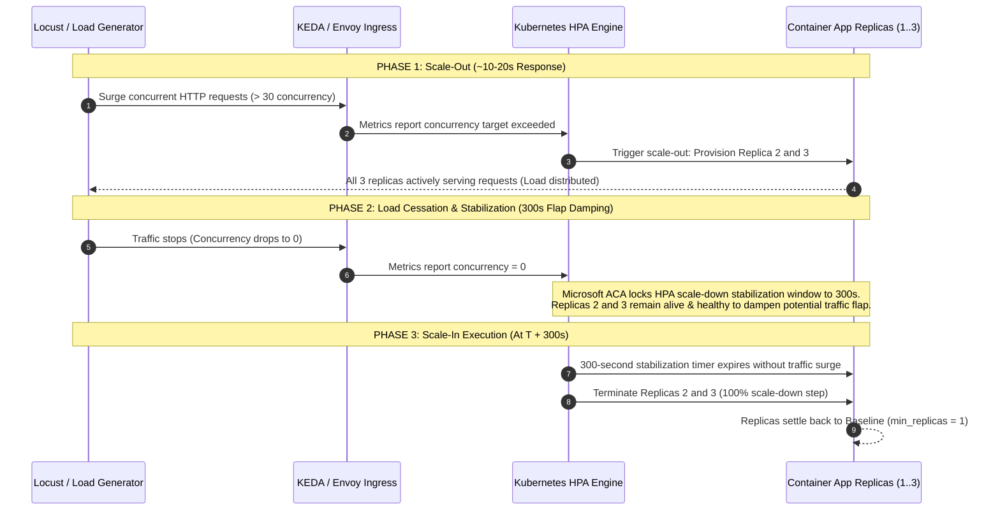

# Autoscaling Architecture, KEDA Rules, and Live Demo Playbook

**Tracking:** `EWSS-30` (`AS-CN-T-L-01`: Verify scale-out, scale-in and replica health)
**Parent Epic:** `AS-SC` / `EWSS-11` (Scaling Targets & Acceptance Analysis)
**Track:** SWE5001 Practice Module (Architecting Scalable Systems)
**Author:** Team 5 DevSecOps & Cloud Platform
**Target Environment:** Azure Container Apps (`rg-ewastescalable-prod` in `malaysiawest` / `indonesiacentral`)

---

## 1. Executive Summary

This document serves as the authoritative reference for horizontal autoscaling behavior, KEDA scale rules, trigger thresholds, and timing windows across the **team5-ewaste-scalable-systems** platform. It provides the exact technical and architectural justifications required for project presentations, viva evaluations, and live scale demonstrations.

---

## 2. Autoscaling Controls Matrix (All 7 Workloads)

Each microservice runs in Azure Container Apps (Consumption profile) with dedicated horizontal pod autoscaling rules defined via Terraform.

| Microservice Component          | Azure Resource Name (`target_env=prod`) | Port & Ingress  | Baseline Replicas (`min`) | Peak Replicas (`max`) |   CPU / Memory   | Scaler Type | Trigger Metric & Threshold                              | Scale-Out Response | Scale-In Window |
| :------------------------------ | :-------------------------------------- | :-------------: | :-----------------------: | :-------------------: | :--------------: | :---------: | :------------------------------------------------------ | :----------------: | :-------------: |
| **PWA Gateway & Reverse Proxy** | `aca-ewastescalable-prod-ui`            | 3000 (External) |           **1**           |         **2**         | 0.5 vCPU / 1 GiB |   `http`    | **50 concurrent requests**                              |       ~15 s        |    **300 s**    |
| **Identity & Access API**       | `aca-ewastescalable-prod-auth`          | 8080 (Internal) |           **1**           |         **2**         | 0.5 vCPU / 1 GiB |   `http`    | **30 concurrent requests**                              |       ~15 s        |    **300 s**    |
| **Batch Workflow API**          | `aca-ewastescalable-prod-api`           | 8080 (Internal) |           **1**           |         **3**         | 0.5 vCPU / 1 GiB |   `http`    | **30 concurrent requests**                              |       ~15 s        |    **300 s**    |
| **Claim Logistics API**         | `aca-ewastescalable-prod-claim`         | 8080 (Internal) |           **1**           |         **3**         | 0.5 vCPU / 1 GiB |   `http`    | **30 concurrent requests**                              |       ~15 s        |    **300 s**    |
| **Custody Verification API**    | `aca-ewastescalable-prod-custody`       | 8080 (Internal) |           **1**           |         **3**         | 0.5 vCPU / 1 GiB |   `http`    | **30 concurrent requests**                              |       ~15 s        |    **300 s**    |
| **Matching Event Worker**       | `aca-ewastescalable-prod-matcher`       | None (Internal) |           **1**           |         **3**         | 0.5 vCPU / 1 GiB |   `kafka`   | **50 uncommitted messages lag** (`ewaste.batch.events`) |       ~20 s        |    **300 s**    |
| **Analytics Event Worker**      | `aca-ewastescalable-prod-analytic`      | 8000 (Internal) |           **1**           |         **3**         | 0.5 vCPU / 1 GiB |   `kafka`   | **50 uncommitted messages lag** (`ewaste.batch.events`) |       ~20 s        |    **300 s**    |

---

## 3. Scale Rule Implementation in Terraform

### 3.1 HTTP Ingress Concurrency Scaler

Applied to all synchronous APIs (`batch-workflow-svc`, `claim-logistics-svc`, `custody-verification-svc`, `identity-access-svc`) and UI reverse proxy:

```hcl
template {
  min_replicas = 1
  max_replicas = 3

  container {
    name   = "service"
    image  = "${var.shared_acr_name}.azurecr.io/ewaste-batch-workflow-svc:${var.image_digest}"
    cpu    = 0.5
    memory = "1Gi"
  }

  custom_scale_rule {
    name             = "http-concurrency-scaler"
    custom_rule_type = "http"
    metadata = {
      concurrentRequests = "30"
    }
  }
}
```

### 3.2 Kafka Consumer Lag Scaler (Event Hubs Surface)

Applied to asynchronous workers consuming partition events from Azure Event Hubs:

```hcl
template {
  min_replicas = 1
  max_replicas = 3

  container {
    name   = "worker"
    image  = "${var.shared_acr_name}.azurecr.io/ewaste-matching-worker-svc:${var.image_digest}"
    cpu    = 0.5
    memory = "1Gi"
  }

  custom_scale_rule {
    name             = "kafka-consumer-lag-scaler"
    custom_rule_type = "kafka"
    metadata = {
      bootstrapServers = "${azurerm_eventhub_namespace.kafka.name}.servicebus.windows.net:9093"
      consumerGroup    = "matching-worker"
      topic            = "ewaste.batch.events"
      lagThreshold     = "50"
      tls              = "enable"
      sasl             = "plaintext"
    }
    authentication {
      trigger_parameter = "username"
      secret_name       = "kafka-username"
    }
    authentication {
      trigger_parameter = "password"
      secret_name       = "kafka-conn"
    }
  }
}
```

---

## 4. Scaling Dynamics & Timing Architecture



### 4.1 Why Scale-Out is Fast (~15s) while Scale-In Takes 300s

1. **Scale-Out Latency ($\approx 15\text{ seconds}$):**
   - KEDA polls active Envoy ingress metrics every 15–30 seconds.
   - When concurrent requests exceed the target threshold (`30`), KEDA computes:
     $$\text{Target Replicas} = \min\left(\text{max\_replicas}, \left\lceil \frac{\text{Active Concurrent Requests}}{\text{Target Concurrency}} \right\rceil\right)$$
   - Pod provisioning starts immediately in parallel.
2. **Scale-In Stabilization Window ($300\text{ seconds}$):**
   - In Azure Container Apps, active replica scale-in ($N \to 1$) is managed by the underlying **Kubernetes Horizontal Pod Autoscaler (HPA)**.
   - Microsoft **hardcodes the HPA scale-down stabilization window to 300 seconds (5 minutes)**.
   - Microsoft does not expose `scaleDown.stabilizationWindowSeconds` or HPA behavior policies in ARM, Bicep, Terraform, or Azure CLI. Passing `cooldownPeriod` at the ARM level for multi-replica apps causes an ARM schema validation error: `400 Bad Request: Unknown properties cooldownPeriod, pollingInterval in ContainerAppScale`.
3. **Difference from `cooldownPeriod` (Scale-to-Zero):**
   - The `cooldownPeriod` setting in KEDA applies exclusively to **Scale-to-Zero ($1 \to 0$ replicas)** when `minReplicas = 0`.
   - Because our services enforce `min_replicas = 1` across all microservices (to eliminate cold-start latency for donors, recyclers, and collectors), scale-to-zero is intentionally inactive. Downscaling from $3 \to 1$ is governed entirely by the 300-second HPA stabilization window.

### 4.2 Flap Damping Architectural Justification (Viva / Evaluation Defense)

When explaining the 300-second scale-in window to evaluators:

> _"In production cloud environments, scaling down too rapidly (e.g., within 30 seconds) triggers **autoscaler flapping**—a destructive cycle where temporary dips in user traffic cause containers to be destroyed and immediately re-created. Azure Container Apps enforces a 300-second stabilization window to prevent flapping, preserving database connection pools, warm application caches, and avoiding container startup CPU penalties."_

---

## 5. Live Demonstration & Verification Playbook (PowerShell)

### 5.1 Real-Time Replica Watcher

Run this PowerShell loop during the demonstration to observe replica counts in real-time:

```powershell
# Continuous watcher for replica scaling
while ($true) {
    $count = (az containerapp replica list `
      --name aca-ewastescalable-prod-api `
      --resource-group rg-ewastescalable-prod `
      --query "length(@)" -o tsv)
    $ts = Get-Date -Format "HH:mm:ss"
    Write-Host "[$ts] Active Replicas: $count" -ForegroundColor Cyan
    Start-Sleep -Seconds 5
}
```

### 5.2 Driving Load to Trigger Scale-Out

Use the repository load generator script or a quick PowerShell concurrency loop:

```powershell
# Drive 60 concurrent requests to trigger scale-out to 2-3 replicas
$targetUrl = "https://nextjs-platform-app.proudsky.azurecontainerapps.io/api/v1/batches?status=COMPLETED"
1..60 | ForEach-Object -Parallel {
    param($url)
    1..20 | ForEach-Object {
        try { Invoke-RestMethod -Uri $url -Method Get -TimeoutSec 10 | Out-Null } catch {}
    }
} -ArgumentList $targetUrl
```

### 5.3 Querying Scale-Event Log in Log Analytics (For Course Artifact)

Run this query in Azure Log Analytics (`log-ewastescalable-centralized`) to export the timestamped scale events:

```kql
ContainerAppSystemLogs_CL
| where ContainerAppName_s == "aca-ewastescalable-prod-api"
| where Log_s contains "Scaled" or Log_s contains "replica"
| project TimeGenerated, ContainerAppName_s, Log_s
| order by TimeGenerated desc
| take 50
```
