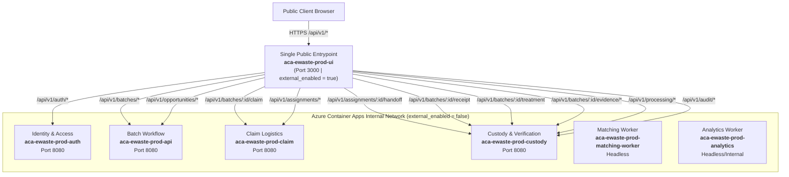

# Single Public Entry Point & Path-Based Routing (Decision AD4)

**Jira Subtask:** `AS-CN-I-L-03` (`EWSS-29`)
**Stage:** Implementation (0.30 person-days)
**Predecessors:** `AS-CN-I-L-02` (`EWSS-27`), Decision `AD4`
**Owner:** Lakshanya Poovannan

---

## 1. Architectural Context & Decision AD4

Per **Decision AD4** recorded in the _Architecting Scalable Systems Delivery Plan_:

> **AD4 Single Entry:** One public address routes UI and API paths to the owning service, using Container Apps ingress routing or a small gateway container. Direct public access to internal microservices is closed.

In our decoupled microservices architecture, six distinct microservices and workers operate inside the Azure Container Apps Environment (`cae-ewaste-prod`) connected to the internal Virtual Network (`vnet-ewaste-prod`):

1. **Frontend UI & Reverse Proxy Gateway:** `aca-ewaste-prod-ui` (Next.js 16 / React 19)
2. **Identity & Access Service:** `aca-ewaste-prod-auth` (Go 1.23 API)
3. **Batch Workflow Service:** `aca-ewaste-prod-api` (Go 1.23 API)
4. **Claim Logistics Service:** `aca-ewaste-prod-claim` (Go 1.23 API)
5. **Custody & Verification Service:** `aca-ewaste-prod-custody` (Go 1.23 API)
6. **Matching Worker Service:** `aca-ewaste-prod-matching-worker` (Python 3.12 Headless Worker)
7. **Analytics Worker Service:** `aca-ewaste-prod-analytics` (Python 3.12 Worker)

### Security Boundary & Attack Surface Reduction

Direct exposure of internal microservices exposes individual REST endpoints, port allocations, and service-to-service interfaces to the public internet. By establishing the **Frontend UI Application as the Single Public Ingress Gateway**:

- **Single Public Entry:** Only `aca-ewaste-prod-ui` enables external ingress (`external_enabled = true`) on HTTPS port 3000.
- **Zero Direct Access:** All backend Go APIs and Python workers have `external_enabled = false` (or headless). They possess no public IP addresses or public DNS records, communicating exclusively via internal Azure Container Apps DNS (`<app-name>.<internal-dns>`) within the delegated ACA subnet (`10.0.3.0/23`).

---

## 2. Path-Based Route Map

The Next.js reverse proxy engine (`src/frontend/next.config.ts`) inspects incoming path prefixes and proxies traffic directly to the owning microservice container over internal ACA DNS:



### Route Prefix Mapping Table

| Public Path Pattern                     | Owning Bounded Context | Internal Service Destination                                      | Ingress Target Port | Description                                    |
| :-------------------------------------- | :--------------------- | :---------------------------------------------------------------- | :------------------ | :--------------------------------------------- |
| `/api/v1/auth/:path*`                   | Identity & Access      | `${IDENTITY_ACCESS_URL}/v1/auth/:path*`                           | 8080                | Authentication, login, token refresh           |
| `/api/v1/batches/:id/claim`             | Claim Logistics        | `${CLAIM_LOGISTICS_URL}/v1/claims/batches/:id`                    | 8080                | Atomic collector batch claiming                |
| `/api/v1/batches/:id/assignments`       | Claim Logistics        | `${CLAIM_LOGISTICS_URL}/v1/logistics/assignments/batches/:id`     | 8080                | Batch assignment retrieval                     |
| `/api/v1/assignments/:id/handoff`       | Custody & Verification | `${CUSTODY_VERIFICATION_URL}/v1/custody/assignments/:id/handoff`  | 8080                | Collector-to-processor handoff verification    |
| `/api/v1/assignments/:path*`            | Claim Logistics        | `${CLAIM_LOGISTICS_URL}/v1/logistics/assignments/:path*`          | 8080                | Collector work management (accept/reject/fail) |
| `/api/v1/batches/:id/receipt`           | Custody & Verification | `${CUSTODY_VERIFICATION_URL}/v1/processing/batches/:id/receipt`   | 8080                | Inbound batch receipt confirmation             |
| `/api/v1/batches/:id/treatment`         | Custody & Verification | `${CUSTODY_VERIFICATION_URL}/v1/processing/batches/:id/treatment` | 8080                | Processing treatment outcome recording         |
| `/api/v1/batches/:id/evidence/:path*`   | Custody & Verification | `${CUSTODY_VERIFICATION_URL}/v1/evidence/batches/:id/:path*`      | 8080                | Private blob evidence upload & metadata        |
| `/api/v1/processing/:path*`             | Custody & Verification | `${CUSTODY_VERIFICATION_URL}/v1/processing/:path*`                | 8080                | Processor batches list and status queries      |
| `/api/v1/audit/:path*`                  | Custody & Verification | `${CUSTODY_VERIFICATION_URL}/v1/audit/:path*`                     | 8080                | Sustainability & ESG impact audit reporting    |
| `/api/v1/batches/:id/analytics-input`   | Batch Workflow         | `${BATCH_WORKFLOW_URL}/internal/v1/analytics/batches/:id/input`   | 8080                | Matcher/Analytics facade input payload         |
| `/api/v1/batches/:id/analytics-results` | Batch Workflow         | `${BATCH_WORKFLOW_URL}/internal/v1/analytics/batches/:id/results` | 8080                | Matcher/Analytics results submission           |
| `/api/v1/opportunities/:path*`          | Batch Workflow         | `${BATCH_WORKFLOW_URL}/v1/opportunities/:path*`                   | 8080                | Available recycling opportunities              |
| `/api/v1/batches/:path*`                | Batch Workflow         | `${BATCH_WORKFLOW_URL}/v1/batches/:path*`                         | 8080                | Batch lifecycle CRUD & status management       |
| `/api/v1/:path*`                        | Fallback (Monolith)    | `${API_PROXY_TARGET}/api/v1/:path*`                               | 8080                | Preserves single-binary compatibility          |

---

## 3. Infrastructure & Ingress Implementation

### 3.1 Next.js Configuration (`src/frontend/next.config.ts`)

The Next.js reverse proxy detects environment variables dynamically:

- Canonical variables: `IDENTITY_ACCESS_URL`, `BATCH_WORKFLOW_URL`, `CLAIM_LOGISTICS_URL`, `CUSTODY_VERIFICATION_URL`.
- Alias variables: `AUTH_SERVICE_URL`, `BATCH_SERVICE_URL`, `CLAIM_SERVICE_URL`, `CUSTODY_SERVICE_URL`.
- Enforces atomic split routing: either all 4 services are configured, or it cleanly falls back to the monolithic API target (`API_PROXY_TARGET`).

### 3.2 Terraform Container Apps Configuration (`terraform/environments/main.tf`)

- **Single Public Ingress:**
  ```hcl
  resource "azurerm_container_app" "ui" {
    name = "aca-${local.name_prefix}-ui"
    ...
    ingress {
      external_enabled = true
      target_port      = 3000
      transport        = "auto"
    }
  }
  ```
- **Internal Service Isolation:**
  ```hcl
  resource "azurerm_container_app" "auth" {
    ingress { external_enabled = false, target_port = 8080 }
  }
  resource "azurerm_container_app" "api" {
    ingress { external_enabled = false, target_port = 8080 }
  }
  resource "azurerm_container_app" "claim" {
    ingress { external_enabled = false, target_port = 8080 }
  }
  resource "azurerm_container_app" "custody" {
    ingress { external_enabled = false, target_port = 8080 }
  }
  resource "azurerm_container_app" "analytics" {
    ingress { external_enabled = false, target_port = 8000 }
  }
  ```
- **Terraform Output (`terraform/environments/outputs.tf`):**
  ```hcl
  output "public_entrypoint_url" {
    value       = "https://${azurerm_container_app.ui.ingress[0].fqdn}"
    description = "Single public HTTPS entrypoint URL routing UI and API requests (Decision AD4)."
  }
  ```

---

## 4. Verification & Testing

### 4.1 Unit Tests (`src/frontend/next.config.test.ts`)

The Vitest test suite exercises all routing rules:

- Verifies all 19 path prefix patterns route to their owning microservice.
- Confirms port retention for custom internal ports.
- Verifies rejection of partial split configurations.
- Tests fallback to monolith proxy when split variables are unset.
- Tests resolution via both canonical and alias environment variable names.

### 4.2 Automated Contract Verification (`scripts/verify_single_entry.py`)

Executes static verification of routing contracts and infrastructure security definitions:

```bash
python scripts/verify_single_entry.py
```

**Test Results:**

- 11/11 Next.js route rewrite targets verified.
- 7/7 Container App ingress security postures verified (`ui` public, 5 internal services closed, 1 headless).
- 8/8 UI container app environment variable bindings verified.
- **Status:** 26 passed, 0 failed.

### 4.3 End-to-End Route & Isolation Test Script (`scripts/test-single-entry-routing.sh`)

An automated bash test runner capable of executing against live Azure Container Apps environments:

1. **Stage 1 (Public Gateway Health):** Confirms public HTTPS connectivity to `https://aca-ewaste-prod-ui...` (returns HTTP 200).
2. **Stage 2 (Path-Based Route Traversal):** Sends test requests through the single public entrypoint for all 4 microservice domains (`/api/v1/auth/login`, `/api/v1/batches`, `/api/v1/assignments`, `/api/v1/processing/batches`) and asserts that backend services respond.
3. **Stage 3 (Closed Direct Access Assertion):** Attempts direct public HTTPS connections to internal microservice FQDNs and verifies that direct public access is blocked (`000` / connection refused / DNS non-resolution).
