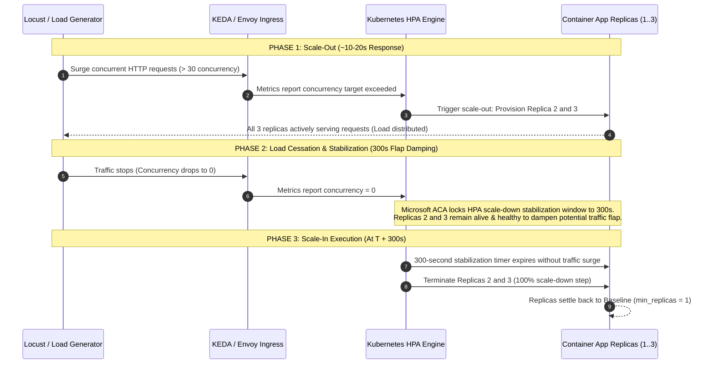

# Physical Architecture, Scale Rules, and Single Entry Design

**Subtask ID:** `AS-CN-D-L-01` (Design the physical architecture, scale rules and single entry)
**Jira Tracking:** `EWSS-2` / `EWSS-16` (Parent Epic: `AS-PREP` / `EWSS-10`)
**Track:** SWE5001 Practice Module (Architecting Scalable Systems)
**Stage:** Design
**Estimate:** 0.40 person-days
**Author:** Lakshanya Poovannan (DevSecOps & Cloud Platform Lead)
**Cross-Artifact Traceability & Alignment:**

- `AS-CN-A-L-01` / `EWSS-10`: Credit Estimate & Deployment Prerequisites (`THIRD_ENVIRONMENT_CREDIT_AND_DEPLOYMENT_ANALYSIS.md`)
- `AS-MS-A-J-01` / `EWSS-9`: Bounded Context & Ownership Map (`EWSS-EWSS-9 Bounded Context and Ownership Map-141026-031253.pdf`)
- `AS-SC-A-K-01` / `EWSS-11`: Scaling Targets & Acceptance Analysis (`EWSS-EWSS-11-141026-031326.pdf`)
- `AS-SC-D-K-01` / `EWSS-17`: Scale Experiment Protocol & SQL Verification (`EWSS-EWSS-17-141026-031352.pdf`)
- `AD1` to `AD7`: Delivery & Jira Plan Decisions (`Architecting Scalable Systems - Delivery and Jira plan.docx`)
- **Downstream Dependents:** `EWSS-27` (`AS-CN-I-L-01` Scale Environment & Pipeline), `EWSS-29` (`AS-CN-I-L-02` Container Apps & Scale Rules), `EWSS-30` (`AS-CN-T-L-01` Verify scale-out, scale-in and replica health)

---

## 1. Executive Summary & Design Governance

This design fixes the physical cloud infrastructure, network topology, single public entry routing, and horizontal pod autoscaling rules for the **team5-ewaste-platform** scaling demonstration scheduled for **Wednesday, 21 October 2026**.

### Cross-Artifact Synchronization Highlights

1. **vCPU Quotas Delineated:** Confirmed that the student subscription’s 4 to 6 vCPU quota is strictly an **IaaS VM core limit** (`Total Regional vCPUs`), consumed only by the self-hosted runner VM (`vm-runner-ewaste-prod`, 2 vCPUs). **Azure Container Apps (ACA) in Consumption profile** operates on an independent serverless fleet, allowing the 7 containerized workloads to scale to 3 replicas (~10.0 vCPUs aggregate) during the 21 October scaling demonstration without VM quota contention.
2. **KEDA Native `kafka` Scaler:** Pointed directly at Event Hubs' Kafka port `9093` (`evh-ewaste-prod.servicebus.windows.net:9093`) with `sasl_ssl` / `PLAIN`, matching the Kafka protocol offset commits used by Python workers (`EWSS-9` and `EWSS-17`).
3. **Route & Ownership Map Synchronized (`EWSS-9` & `EWSS-17`):**
   - `/api/v1/assignments/{id}/handoff` routed to `custody-verification-svc` (custody transition).
   - All other `/api/v1/assignments/*` and `/api/v1/batches/{id}/claim` routed to `claim-logistics-svc` (claim locking & collector dispatch).
   - Internal analytics worker endpoints (`GET /analytics-input` and `POST /analytics-results`) routed to **`batch-workflow-svc`** as the authoritative batch lifecycle facade (`EWSS-9`, Section 2).
   - Audit projections (`/api/v1/audit/*`) and facility processing (`/api/v1/processing/batches/*`) routed to `custody-verification-svc`.
4. **Canonical Event Topics & Partitions (`EWSS-9`, `EWSS-11`, `EWSS-17`):** Aligned with the 6 canonical Terraform topics (`ewaste.batch.events`, `ewaste.claim.events`, etc.), raising partitions to **3** for active lifecycle topics to support 3-replica parallel consumption.

---

## 2. Physical Architecture View

### 2.1 Structural Cloud Topology & Network Segmentation

```mermaid
flowchart TD
    subgraph Public_Internet["Public Internet & External Actors"]
        ACT_DONOR["Donors & Business Reps<br/>(Desktop Web)"]
        ACT_RECYCLER["Recyclers & Processors<br/>(Desktop Web)"]
        ACT_COLLECTOR["Field Collectors<br/>(Installable PWA)"]
        ACT_AUDITOR["Auditors & Admins<br/>(Desktop Web)"]
    end

    subgraph Azure_Subscription["Azure for Students Subscription (Shalett)"]
        subgraph Perimeter["Perimeter Entry (Decision AD4)"]
            PUB_ENTRY["Single Public Entry Point<br/>FQDN: nextjs-platform-app.proudsky.azurecontainerapps.io<br/>Port 443 HTTPS / TLS 1.3"]
        end

        subgraph VNET["Virtual Network: vnet-ewaste-prod (10.0.0.0/16)"]
            subgraph SNET_ACA["Subnet: snet-aca (10.0.2.0/23) — Delegated to Microsoft.App/environments"]
                subgraph CAE["Container App Environment: cae-ewaste-prod (Single CAE Quota)"]
                    UI["nextjs-platform-app<br/>(Next.js PWA + Path Reverse Proxy)<br/>Port 3000 | Replicas: 1..2"]

                    subgraph Backend_Go_APIs["Core Go Microservices (Port 8080, Internal Ingress Only)"]
                        API_AUTH["identity-access-svc<br/>Auth & Session Tokens<br/>Replicas: 1..2"]
                        API_BATCH["batch-workflow-svc<br/>Batch Lifecycle & Outbox Relay<br/>Replicas: 1..3 (AD5 Target)"]
                        API_CLAIM["claim-logistics-svc<br/>FCFS Claim Lock & Dispatch<br/>Replicas: 1..3"]
                        API_CUSTODY["custody-verification-svc<br/>Handoff, Verification & Evidence<br/>Replicas: 1..3"]
                    end

                    subgraph Async_Workers["Asynchronous Kafka Event Workers (Zero Ingress Ports)"]
                        WRK_MATCH["matching-worker-svc (Python 3.12)<br/>Group: matching-worker<br/>Replicas: 1..3"]
                        WRK_ANALYTICS["analytics-worker-svc (Python 3.12)<br/>Group: analytics-worker<br/>Replicas: 1..3"]
                    end
                end
            end

            subgraph SNET_DB["Subnet: snet-mysql (10.0.1.0/24)"]
                MYSQL["Azure Database for MySQL Flexible Server<br/>mysql-ewaste-prod.privatelink.mysql.database.azure.com<br/>B_Standard_B1ms (Authoritative System of Record)"]
            end

            subgraph SNET_PE["Subnet: snet-private-endpoints (10.0.3.0/24)"]
                PE_REDIS["Private Endpoint: Redis Cache<br/>pe-redis-ewaste-prod (10.0.3.4)"]
                PE_ACR["Private Endpoint: Shared ACR<br/>pe-acr-ewaste-prod (10.0.3.5)"]
                PE_BLOB["Private Endpoint: Evidence Storage<br/>pe-blob-ewaste-prod (10.0.3.6)"]
            end

            subgraph SNET_RUNNER["Subnet: snet-runner (10.0.4.0/24)"]
                VM_RUNNER["Self-Hosted CI/CD Runner VM<br/>vm-runner-ewaste-prod<br/>Standard_B2als_v2 (Docker + Liquibase)<br/>Uses 2 vCPUs of VM Quota"]
            end
        end

        subgraph Managed_PaaS["Managed Platform Services"]
            REDIS["Azure Cache for Redis (Basic C0)<br/>redis-ewaste-prod<br/>Distributed Claim Leases & Idempotency"]
            EVH["Azure Event Hubs (Standard 1 TU, Kafka 1.0+ Surface)<br/>evh-ewaste-prod.servicebus.windows.net:9093"]
            BLOB["Azure Blob Storage (Hot LRS)<br/>stgewasteprod<br/>Private Evidence Store (ADR D2)"]
        end

        subgraph Shared_Tier["Shared Platform Tier (rg-ewaste-shared)"]
            ACR["Azure Container Registry (Premium)<br/>acrewasteplatform (Japan East)<br/>Signed Immutable Container Images"]
            LOGS["Log Analytics Workspace<br/>log-ewaste-centralized (Malaysia West)<br/>Central Telemetry & Scaling Metrics"]
        end
    end

    %% External User Access
    ACT_DONOR -->|HTTPS:443| PUB_ENTRY
    ACT_RECYCLER -->|HTTPS:443| PUB_ENTRY
    ACT_COLLECTOR -->|HTTPS:443| PUB_ENTRY
    ACT_AUDITOR -->|HTTPS:443| PUB_ENTRY

    %% Single Entry Routing (Internal VNet DNS)
    PUB_ENTRY -->|/* UI Assets| UI
    PUB_ENTRY -->|/api/v1/auth/*| API_AUTH
    PUB_ENTRY -->|/api/v1/batches/* (lifecycle & opportunities)| API_BATCH
    PUB_ENTRY -->|/api/v1/batches/:id/claim| API_CLAIM
    PUB_ENTRY -->|/api/v1/assignments/* (except handoff)| API_CLAIM
    PUB_ENTRY -->|/api/v1/assignments/:id/handoff| API_CUSTODY
    PUB_ENTRY -->|/api/v1/processing/* & /audit/*| API_CUSTODY

    %% Persistence & Streaming
    Backend_Go_APIs -->|Port 3306| MYSQL
    API_CLAIM -->|Port 6380 TLS| PE_REDIS
    PE_REDIS -.-> REDIS
    API_BATCH -->|Kafka:9093 SASL_SSL| EVH
    API_CLAIM -->|Kafka:9093 SASL_SSL| EVH
    API_CUSTODY -->|Kafka:9093 SASL_SSL| EVH
    API_CUSTODY -->|Blob HTTPS| PE_BLOB
    PE_BLOB -.-> BLOB

    %% Kafka Consumer Workers & Internal Facades (EWSS-9)
    EVH -->|ewaste.batch.events| WRK_MATCH
    EVH -->|ewaste.batch.events & ewaste.claim.events| WRK_ANALYTICS
    WRK_MATCH -->|POST /api/v1/batches/:id/matching-decision| API_BATCH
    WRK_ANALYTICS -->|GET /analytics-input & POST /analytics-results| API_BATCH

    %% In-VNet CI/CD Runner
    VM_RUNNER -->|Liquibase Migrations:3306| MYSQL
    VM_RUNNER -->|Private Link Image Pull/Push| PE_ACR
    PE_ACR -.-> ACR
```

---

### 2.2 Cloud Quota Analysis & Multi-Replica Feasibility

| Quota Category                                      | Azure Scope                           | Student Quota Cap                     | Platform Allocation                                           | Feasibility & Headroom                                                                                          |
| :-------------------------------------------------- | :------------------------------------ | :------------------------------------ | :------------------------------------------------------------ | :-------------------------------------------------------------------------------------------------------------- |
| **IaaS VM Regional vCPUs** (`Total Regional vCPUs`) | `Microsoft.Compute` in `malaysiawest` | **4 to 6 vCPUs**                      | **2 vCPUs** (`vm-runner-ewaste-prod`)                         | **Feasible:** Leaves 2 to 4 cores headroom. Only 1 runner VM is provisioned.                                    |
| **Container Apps Serverless Compute**               | `Microsoft.App/environments`          | **20 to 100 vCPUs** (Serverless pool) | Baseline: **4.0 vCPUs**<br/>Peak (3 replicas): **10.0 vCPUs** | **Feasible:** ACA Consumption does not draw from the IaaS VM quota. Scales to 3 replicas without quota failure. |
| **Container App Environment (CAE)**                 | `Microsoft.App/managedEnvironments`   | **Exactly 1 CAE**                     | **1 CAE** (`cae-ewaste-prod`)                                 | **Feasible:** Dedicated to production; avoids `ContainerAppEnvironmentQuotaExceeded`.                           |

---

## 3. Single Entry Routing Architecture (Decision AD4)

External requests arrive at the public FQDN on `nextjs-platform-app` (Port 443 / TLS 1.3). The application acts as a reverse proxy gateway routing to internal microservices via internal VNet DNS. Direct public ingress to backend APIs is closed (`external_enabled = false`).

### 3.1 Canonical Path Routing Map (Synced with `EWSS-9`, `EWSS-17` & `openapi.yaml`)

| Ingress Path Pattern                                                                                                                                                                                                                                                                                  | Destination Microservice       | Internal Port | Protocol | Owning Bounded Context & Responsibilities (`EWSS-9`)                                                                   |
| :---------------------------------------------------------------------------------------------------------------------------------------------------------------------------------------------------------------------------------------------------------------------------------------------------- | :----------------------------- | :------------ | :------- | :--------------------------------------------------------------------------------------------------------------------- |
| `/*` (HTML, JS, PWA Assets, `/healthz`)                                                                                                                                                                                                                                                               | `nextjs-platform-app`          | `3000`        | HTTP/1.1 | PWA application shell, offline service worker, collector views.                                                        |
| `/api/v1/auth/login`<br/>`/api/v1/auth/refresh`<br/>`/api/v1/auth/logout`                                                                                                                                                                                                                             | `identity-access-svc`          | `8080`        | HTTP/1.1 | **Identity & Access Context:** User authentication, JWT issuance/rotation, session revocation.                         |
| `/api/v1/batches` (GET, POST)<br/>`/api/v1/batches/{batch_id}` (GET, PATCH)<br/>`/api/v1/batches/{batch_id}/submit` (POST)                                                                                                                                                                            | `batch-workflow-svc`           | `8080`        | HTTP/1.1 | **Batch Workflow Context:** Donor draft creation, submission, state machine, outbox event persistence.                 |
| `/api/v1/opportunities`<br/>`/api/v1/opportunities/{batch_id}`                                                                                                                                                                                                                                        | `batch-workflow-svc`           | `8080`        | HTTP/1.1 | **Matching Opportunities:** Recycler opportunity discovery and capacity inspection.                                    |
| `/api/v1/batches/{batch_id}/analytics-input` (GET)<br/>`/api/v1/batches/{batch_id}/analytics-results` (POST)                                                                                                                                                                                          | `batch-workflow-svc`           | `8080`        | HTTP/1.1 | **Analytics Facade:** Freezes input snapshots and acknowledges derived results before final completion (`EWSS-9`).     |
| `/api/v1/batches/{batch_id}/claim` (POST)                                                                                                                                                                                                                                                             | `claim-logistics-svc`          | `8080`        | HTTP/1.1 | **Claim Logistics Context:** FCFS atomic Redis lock acquisition and MySQL row-lock transaction.                        |
| `/api/v1/batches/{batch_id}/assignments` (POST)<br/>`/api/v1/assignments` (GET)<br/>`/api/v1/assignments/{assignment_id}` (GET)<br/>`/api/v1/assignments/{assignment_id}/accept` (POST)<br/>`/api/v1/assignments/{assignment_id}/reject` (POST)<br/>`/api/v1/assignments/{assignment_id}/fail` (POST) | `claim-logistics-svc`          | `8080`        | HTTP/1.1 | **Collector Logistics & Dispatch:** Active collector round-robin assignment, collector task queue, rejection handling. |
| **`/api/v1/assignments/{assignment_id}/handoff` (POST)**                                                                                                                                                                                                                                              | **`custody-verification-svc`** | `8080`        | HTTP/1.1 | **Physical Custody Transition:** Collector handoff to facility, version check, custody event publication.              |
| `/api/v1/batches/{batch_id}/receipt` (POST)<br/>`/api/v1/batches/{batch_id}/treatment` (POST)<br/>`/api/v1/batches/{batch_id}/evidence` (POST)<br/>`/api/v1/batches/{batch_id}/evidence/{evidence_id}` (GET)<br/>`/api/v1/processing/batches` (GET)<br/>`/api/v1/processing/batches/{batch_id}` (GET) | `custody-verification-svc`     | `8080`        | HTTP/1.1 | **Custody & Verification Context:** Weighbridge verification, treatment outcome logging, encrypted Azure Blob uploads. |
| `/api/v1/audit/batches/{batch_id}/timeline` (GET)<br/>`/api/v1/audit/batches/{batch_id}/anomalies` (GET)<br/>`/api/v1/audit/impact` (GET)                                                                                                                                                             | `custody-verification-svc`     | `8080`        | HTTP/1.1 | **Audit Read Model:** Custody timeline, material anomaly flags, and deterministic ESG impact views (`EWSS-9`).         |

---

## 4. Event Streaming Architecture: Canonical Topics & Partitions (AD5)

Azure Event Hubs (`evh-ewaste-prod`, Standard SKU) exposes a native Kafka 1.0+ surface over port 9093.

### 4.1 Canonical Topic Matrix & Partition Strategy

Per **AD5** and **`EWSS-11` / `EWSS-17`**, high-throughput lifecycle topics are raised from 1 to **3 partitions** to enable concurrent 3-replica consumption without partition starvation:

| Canonical Topic Name (Terraform)          | Partition Count          | Key Strategy | Primary Consumer Groups                                         | Purpose & Domain Events (`EWSS-9`)                                                                  |
| :---------------------------------------- | :----------------------- | :----------- | :-------------------------------------------------------------- | :-------------------------------------------------------------------------------------------------- |
| **`ewaste.batch.events`**                 | **3** _(Raised for AD5)_ | `batch_id`   | `matching-worker`<br/>`workflow-readers`<br/>`analytics-worker` | Emits `RequestSubmitted`, `MatchingCompleted`, `RequestCompleted`. Drives worker scaling.           |
| **`ewaste.claim.events`**                 | **3** _(Raised for AD5)_ | `batch_id`   | `analytics-worker`<br/>`workflow-readers`                       | Emits `ClaimConfirmed`. Records winning recycler claim.                                             |
| **`batch.collector.assigned`**            | **3** _(Raised for AD5)_ | `batch_id`   | `workflow-readers`<br/>`analytics-worker`                       | Emits `CollectorAssigned`. Dispatches collector.                                                    |
| **`batch.collection.completed`**          | **3** _(Raised for AD5)_ | `batch_id`   | `analytics-worker`<br/>`workflow-readers`                       | Emits `CollectionCompleted` and `ReceiptVerified`.                                                  |
| **`batch.collection.failed`**             | 1                        | `batch_id`   | `workflow-readers`                                              | Emits `CollectionFailed`. Triggers logistics recovery.                                              |
| **`ewaste.batch.events.matching.dlq.v1`** | 1                        | `batch_id`   | `matching-worker-dlq`                                           | Dead-letter queue for malformed or permanently poisoned matching deliveries (`MatchingQuarantine`). |

- **Strict Ordering:** Keying all partition writes by `batch_id` guarantees that all state transitions for a specific batch land in the same partition in chronological sequence.
- **Autoscaling Parallelism:** 3 partitions enable KEDA to scale `matching-worker-svc` and `analytics-worker-svc` to 3 active replicas, where each replica consumes exactly one dedicated partition.

---

## 5. Autoscaling Master Specification & Scale Rules (Demo Reference)

### 5.1 Autoscaling Controls Table (7 Container Apps)

| Logical Component            | Azure Resource Name (`target_env=prod`) | Baseline Replicas (`min`) | Peak Replicas (`max`) | CPU / RAM Allocation | Scaler Type | Trigger Metric & Threshold                              | Scale-Out Latency | Scale-In Window |
| :--------------------------- | :-------------------------------------- | :-----------------------: | :-------------------: | :------------------: | :---------: | :------------------------------------------------------ | :---------------: | :-------------: |
| **Platform Gateway & UI**    | `aca-ewastescalable-prod-ui`            |           **1**           |         **2**         |   0.5 vCPU / 1 GiB   |   `http`    | **50 concurrent requests**                              |       ~15 s       |    **300 s**    |
| **Identity & Access API**    | `aca-ewastescalable-prod-auth`          |           **1**           |         **2**         |   0.5 vCPU / 1 GiB   |   `http`    | **30 concurrent requests**                              |       ~15 s       |    **300 s**    |
| **Batch Workflow API**       | `aca-ewastescalable-prod-api`           |           **1**           |         **3**         |   0.5 vCPU / 1 GiB   |   `http`    | **30 concurrent requests**                              |       ~15 s       |    **300 s**    |
| **Claim Logistics API**      | `aca-ewastescalable-prod-claim`         |           **1**           |         **3**         |   0.5 vCPU / 1 GiB   |   `http`    | **30 concurrent requests**                              |       ~15 s       |    **300 s**    |
| **Custody Verification API** | `aca-ewastescalable-prod-custody`       |           **1**           |         **3**         |   0.5 vCPU / 1 GiB   |   `http`    | **30 concurrent requests**                              |       ~15 s       |    **300 s**    |
| **Matching Event Worker**    | `aca-ewastescalable-prod-matcher`       |           **1**           |         **3**         |   0.5 vCPU / 1 GiB   |   `kafka`   | **50 uncommitted messages lag** (`ewaste.batch.events`) |       ~20 s       |    **300 s**    |
| **Analytics Event Worker**   | `aca-ewastescalable-prod-analytic`      |           **1**           |         **3**         |   0.5 vCPU / 1 GiB   |   `kafka`   | **50 uncommitted messages lag** (`ewaste.batch.events`) |       ~20 s       |    **300 s**    |

---

### 5.2 KEDA Scale Rule Definitions in Terraform

#### A. Stateless Go API HTTP Concurrency Scaler

Applied to `batch-workflow-svc` (the primary target of the `R1` and `R2` load experiments in `EWSS-17`), `claim-logistics-svc`, and `custody-verification-svc`:

```hcl
template {
  min_replicas = 1
  max_replicas = 3

  container {
    name   = "service"
    image  = "${var.shared_acr_name}.azurecr.io/ewaste-batch-workflow-svc:${var.image_digest}"
    cpu    = 0.5
    memory = "1Gi"
  }

  custom_scale_rule {
    name             = "http-concurrency-scaler"
    custom_rule_type = "http"
    metadata = {
      concurrentRequests = "30"
    }
  }
}
```

#### B. Asynchronous Python Worker Kafka Scaler (Pointing to Event Hubs Kafka Surface)

Applied to `matching-worker-svc` and `analytics-worker-svc`:

```hcl
template {
  min_replicas = 1
  max_replicas = 3

  container {
    name   = "worker"
    image  = "${var.shared_acr_name}.azurecr.io/ewaste-matching-worker-svc:${var.image_digest}"
    cpu    = 0.5
    memory = "1Gi"
  }

  custom_scale_rule {
    name             = "kafka-consumer-lag-scaler"
    custom_rule_type = "kafka"
    metadata = {
      bootstrapServers = "${azurerm_eventhub_namespace.kafka.name}.servicebus.windows.net:9093"
      consumerGroup    = "matching-worker"
      topic            = "ewaste.batch.events"
      lagThreshold     = "50"
      tls              = "enable"
      sasl             = "plaintext"
    }
    authentication {
      trigger_parameter = "username"
      secret_name       = "kafka-username"
    }
    authentication {
      trigger_parameter = "password"
      secret_name       = "kafka-conn"
    }
  }
}
```

---

### 5.3 Scaling Dynamics, Timing Windows & Stabilization Architecture (Demo Reference)

During oral project evaluations and architecture defense, examiners frequently probe the exact timing and internal mechanisms governing replica expansion and contraction. Below is the precise architectural breakdown:



#### 1. Why Can Replicas Scale Out in 15s, but Take 300s to Scale In?

- **Scale-Out Latency ($\approx 15\text{ seconds}$):**
  KEDA polls active Envoy ingress metrics every 15–30 seconds. The moment concurrent connections exceed the configured threshold (`30` for API, `50` for UI), KEDA calculates `TargetReplicas = ceil(ActiveRequests / ConcurrencyTarget)` and immediately instructs the runtime to spawn new replica pods.
- **Scale-In Stabilization Window ($300\text{ seconds}$):**
  Multi-replica downscaling ($N \to 1$) is handled by the underlying **Kubernetes Horizontal Pod Autoscaler (HPA)**. In Azure Container Apps (managed serverless), Microsoft **hardcodes the scale-down stabilization window to 300 seconds (5 minutes)**.
- **Platform Architecture Limitation:** Microsoft does not expose `scaleDown.stabilizationWindowSeconds` or HPA behavior policies in ARM, Bicep, Terraform, or Azure CLI. Any attempt to pass `cooldownPeriod` or `pollingInterval` at the ARM level for $N \to 1$ scaling produces HTTP `400 Bad Request: Unknown properties cooldownPeriod, pollingInterval in ContainerAppScale`.
- **`cooldownPeriod` vs. Stabilization Window:**
  The `cooldownPeriod` parameter in KEDA only applies to **Scale-to-Zero ($1 \to 0$ replicas)** when `minReplicas = 0`. Because our production platform enforces `min_replicas = 1` across all microservices (eliminating cold-start penalties for incoming users), scale-to-zero is intentionally inactive, and all downscaling is governed by the 300-second HPA stabilization window.

#### 2. Architectural Justification for Demo Evaluators (Flap Damping)

When explaining the 300-second scale-in window during the demo:

> _"In production enterprise systems, scaling down too quickly (e.g., within 30 seconds) causes **autoscaling flapping** (rapid oscillations of destroying and immediately re-provisioning pods due to momentary traffic pauses or bursty user reloads). Azure Container Apps enforces a 300-second stabilization window to dampen these oscillations, ensuring database connection pools, memory allocations, and TLS sessions remain warm while avoiding unnecessary compute churn."_

---

### 5.4 Live Demonstration Playbook & Operational Verification (PowerShell)

Use these commands during the live demo to prove replica scaling and monitor health:

#### Step 1: Inspect Live Replicas in Real Time

```powershell
# Query current active replicas for the batch workflow API
az containerapp replica list `
  --name aca-ewastescalable-prod-api `
  --resource-group rg-ewastescalable-prod `
  --query "[].{Name:name, CreatedTime:properties.createdTime, State:properties.runningState}" `
  --output table
```

#### Step 2: Continuous Watch Loop During Load Test

```powershell
# Watch replica count transition from 1 -> 3 in PowerShell
while ($true) {
    $count = (az containerapp replica list `
      --name aca-ewastescalable-prod-api `
      --resource-group rg-ewastescalable-prod `
      --query "length(@)" -o tsv)
    $ts = Get-Date -Format "HH:mm:ss"
    Write-Host "[$ts] Active Replicas: $count" -ForegroundColor Cyan
    Start-Sleep -Seconds 5
}
```

#### Step 3: Query Scale-Event Log in Log Analytics (For Course Artifact)

```kql
// Log Analytics KQL Query to capture the exact scale-out and scale-in timeline
ContainerAppSystemLogs_CL
| where ContainerAppName_s == "aca-ewastescalable-prod-api"
| where Log_s contains "Scaled" or Log_s contains "replica"
| project TimeGenerated, ContainerAppName_s, Log_s
| order by TimeGenerated desc
| take 50
```

---

## 6. Scaling Experiment Alignment (`EWSS-11` & `EWSS-17`)

This physical design directly underpins the experimental protocol established by Kaushik in **`EWSS-17`** (`AS-SC-D-K-01`):

1. **Fixed-Workload Isolation (`EWSS-17`, Section 1):**
   - The load test targets exclusively `batch-workflow-svc` via the single public gateway (`nextjs-platform-app`).
   - Workload mix: 40% `GET /api/v1/batches?status=COMPLETED`, 40% `GET /api/v1/batches/{id}`, 10% `POST /api/v1/batches`, 10% `POST /api/v1/batches/{id}/submit`.
   - 100 concurrent virtual users executing closed-loop iterations.
2. **1-Replica vs. 3-Replica Scaling Demonstration (`R2`):**
   - Trial A: `batch-workflow-svc` locked to `min_replicas = 1, max_replicas = 1`. Measure highest sustainable requests/sec and P95 latency.
   - Trial B: `batch-workflow-svc` locked to `min_replicas = 3, max_replicas = 3`. Measure highest sustainable requests/sec.
   - Pass Criteria: Throughput at 3 replicas $\ge 1.5\times$ throughput at 1 replica, with mixed API P95 $< 2,000$ ms and unexpected errors $< 1\%$.
3. **Autoscaling Dynamics (`R4` & `R5`):**
   - Drive traffic exceeding 30 concurrent requests to observe KEDA HTTP scale-out and cooldown scale-in.
   - Generate event burst on `ewaste.batch.events` exceeding 50 messages of lag across 3 partitions to observe worker scale-out from 1 to 3 replicas and verify zero duplicate writes via MySQL idempotent constraints (`EWSS-17`, Section 7).
4. **Claim Contention Burst (`R3`):**
   - Drive 50 concurrent claim requests to `/api/v1/batches/{id}/claim` against a single `MATCHED` batch. Verify Redis lease absorbs the surge and MySQL row-lock admits exactly 1 winner while returning 49 HTTP 409 responses.

---

## 7. Architectural Decisions Sign-Off Matrix

| Decision ID | Subject                   | Architecture State Recorded in this Design                                                              | Cross-Artifact Traceability           |
| :---------- | :------------------------ | :------------------------------------------------------------------------------------------------------ | :------------------------------------ |
| **AD1**     | Repository & Subscription | Separate repo; dedicated student subscription (Shalett) hosting `rg-ewaste-prod` and `cae-ewaste-prod`. | Matches `EWSS-10` & Jira Plan Table 2 |
| **AD2**     | Service Split             | 4 Go API microservices, 2 Python workers, 1 Next.js PWA.                                                | Matches `EWSS-9` Bounded Context Map  |
| **AD3**     | Environment & Credits     | Single persistent CAE in `prod` to respect $100 credit cap through 21 Oct presentation.                 | Matches `EWSS-10` Financial Model     |
| **AD4**     | Single Entry Routing      | Reverse proxy path-prefix routing on `nextjs-platform-app`; private internal backend APIs.              | Matches `EWSS-9` Route Table          |
| **AD5**     | Scale Rules & Partitions  | HTTP concurrency = 30; Kafka lag = 50; Event Hubs partitions = 3; Max replicas = 3.                     | Matches `EWSS-11` & `EWSS-17`         |
| **AD6**     | Scope Trims               | Zone redundancy and Front Door WAF omitted; synthetic load data only.                                   | Matches Jira Plan Section 2           |
| **AD7**     | Jira Space & Tracking     | Tracked under `EWSS` space with prefix `AS-*`.                                                          | Matches Jira Plan Table 2             |
